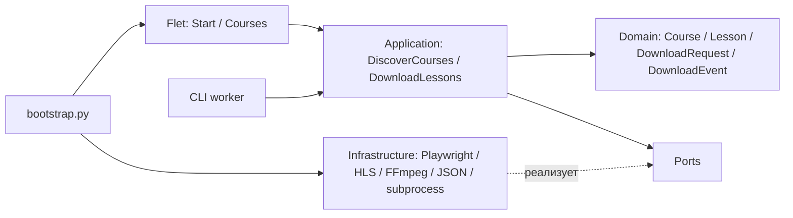

# Архитектура GetCourseVideoDownloader

`domain/` содержит модели, события и ошибки; `application/` — сценарии и порты. `infrastructure/` реализует браузер, обнаружение страниц, загрузку, хранение, worker и диагностику. `presentation/` содержит Flet и CLI. GUI соединяется в `bootstrap.py`; у CLI worker собственная сборка адаптеров в `presentation/cli/worker.py`. Направление импортов domain/application проверяет `tests/test_architecture.py`.

## Где искать

| Задача | Файл / модуль |
| --- | --- |
| Точки входа и сборка зависимостей | `main.py`, `src/getcourse_downloader/__main__.py`, `src/getcourse_downloader/bootstrap.py`, `src/getcourse_downloader/presentation/cli/worker.py` |
| Flet: ввод URL, выбор, прогресс, отмена | `presentation/flet/app.py`, `presentation/flet/screens/start/`, `presentation/flet/screens/courses/` внутри `src/getcourse_downloader/` |
| Сценарии, контракты, модели и события | `src/getcourse_downloader/application/`, `src/getcourse_downloader/domain/` |
| Курсы, уроки, вход и браузерный профиль | `src/getcourse_downloader/infrastructure/getcourse/discovery.py`, `authentication.py`, `infrastructure/browser/playwright.py` |
| Доступ к уроку, перехват медиа и подготовка GetCourse-плеера | `src/getcourse_downloader/infrastructure/getcourse/lesson_access.py`, `downloader.py`, `video_signals.py`, `player_config.py` |
| HLS, идентичность плейлистов, checkpoint и FFmpeg | `src/getcourse_downloader/infrastructure/media/hls.py`, `playlist_identity.py`, `ffmpeg.py` |
| Worker, события и управление процессом | `src/getcourse_downloader/infrastructure/worker/subprocess_gateway.py`, `presentation/cli/worker.py`, `domain/events.py` |
| Настройки, каталог готовых файлов, пути, диагностика | `src/getcourse_downloader/infrastructure/storage/`, `infrastructure/platform/paths.py`, `infrastructure/diagnostics/reports.py` |
| Зависимости, проверки и Windows ZIP | `pyproject.toml`, `uv.lock`, `tests/`, `README.md`, `build.ps1` |

