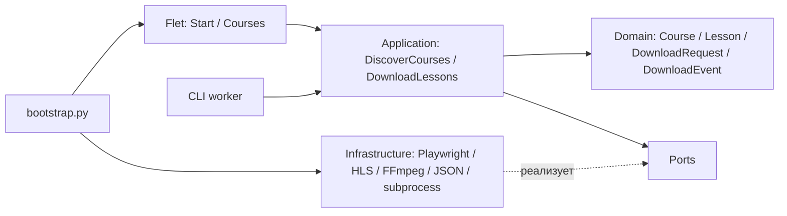

# Архитектура GetCourseVideoDownloader

`domain/` содержит модели, события и ошибки; `application/` — сценарии и порты. `infrastructure/` реализует браузер, обнаружение страниц, загрузку, хранение, worker и диагностику. `presentation/` содержит Flet и CLI. GUI соединяется в `bootstrap.py`; у CLI worker собственная сборка адаптеров в `presentation/cli/worker.py`. Направление импортов domain/application проверяет `tests/test_architecture.py`.

## Главный поток

1. `main.py` запускает Flet (или `--download-worker` / `--self-test`); GUI-скрипт также объявлен в `pyproject.toml`. `StartScreen` передаёт URL через `StartController` в `DiscoverCourses`, который проверяет схему URL и сохраняет найденные курсы через `JsonCourseRepository`.
2. `GetCourseDiscoverer` открывает постоянный профиль Firefox через `PlaywrightBrowserFactory`. При редиректе на вход он открывает видимый браузер, ждёт подтверждения пользователя и повторно проверяет страницу. Затем обходит ссылки GetCourse stream (не более 500 узлов, до 4 одновременно) и строит дерево `Course`. HTTP 403 у отдельного найденного курса или модуля помечает его как пропущенный (`CourseDiscoveryUpdate.skipped`), исключает из итогового дерева и не прерывает обход доступных соседей и потомков. Отказ для самой исходной ссылки и другие ошибки остаются явными ошибками. Модули читаются из `tr.training-row` и карточек `.training-list-wrapper a.card-link`, уроки — из `ul.lesson-list li` и `.LessonList-container a.card-link`; названия карточек берутся из `.training-card__header` / `.lesson-card_heading`. Для нового интерфейса код ждёт скрытия `.gc-redesigned .loader-skeleton` до 15 секунд; таймаут даёт `CONTENT_LOAD_TIMEOUT`, а не пустое дерево. Ссылки нормализуются, чужие домены и дубликаты отбрасываются; при отсутствии распознанных модулей сохраняется запасной поиск stream URL в HTML.
3. `CoursesScreen` показывает дерево, выбор уроков/папок и «Выбрать всё». `selected_course_lessons` создаёт список `SelectedLesson`; после выбора папки и качества `CoursesController` формирует `DownloadRequest`. Загрузка начинается по отдельному действию пользователя.
4. `DownloadLessons` проверяет запрос; `SubprocessDownloadGateway` передаёт его дочернему worker через временный JSON и читает типизированные `DownloadEvent` из JSONL. Команды продолжения авторизации и отмены передаются отдельным JSONL-файлом. Worker создаёт `PlaywrightDownloadGateway`.
5. Worker последовательно открывает **выбранные** страницы уроков в авторизованном контексте Firefox. Страница GetCourse «Нет доступа» распознаётся отдельно от отсутствия видео. `PlaywrightDownloadGateway` ограничивает всю проверку одного урока 60 секундами: от создания страницы до выбора потоков, включая подготовку персонального видео. Превышение даёт `VIDEO_CHECK_TIMEOUT` в отчёте урока для «Подробнее»; очередь продолжает работу. Лимит отключается перед передачей управления в `HlsDownloader`, поэтому скачивание и сборка MP4 могут длиться дольше. Адаптер слушает ответы браузера на HLS и ищет HLS-ссылки во фреймах. Запасной поиск проверяет каждый URL-подобный фрагмент HTML один раз, чтобы большие встроенные изображения не блокировали event loop; чтение HTML и запросы найденных плейлистов ограничены по времени, запрос браузера прерывается через `AbortController`. Для GetCourse `/sign-player/` адаптер `player_config.py` также читает известные поля `window.configs`: проверяет текущую готовность, при необходимости запрашивает подготовку персонального видео и получает `masterPlaylistUrl` внутри авторизованного iframe без нажатий. Оба источника передают URL и текст плейлиста в общий выбор качества; потоки сопоставляются со всеми найденными плеерами. `HlsDownloader` отдельной `aiohttp`-сессией получает playlist и сегменты, возобновляет совместимый checkpoint, вызывает `FfmpegMuxer`, атомарно переносит результат в MP4. При отдельной HLS-аудиодорожке она скачивается и объединяется с видео.
6. События обновляют строки уроков, прогресс и итог в Flet через `presentation/flet/lifecycle.py`: UI-callbacks проверяют время жизни экрана до постановки в очередь и перед выполнением. При dispose они отключаются; если сессия уже уничтожена, обработчик закрывает экран и запрашивает отмену ещё активной загрузки. Прочие ошибки не подавляются. `JsonDownloadCatalog` и уже существующие файлы помогают пропускать готовое; `.gcd-part` хранит сегменты для продолжения. Отмена идёт из UI через worker, проверяется между действиями; закрытие экрана может принудительно завершить процесс после ожидания. Ошибки уроков и запуска пишутся в отчёты диагностики атомарно через временный файл и замену; отчёт урока считается сохранённым только после успешной записи. Экран также хранит очищенный снимок первого события ошибки для каждого отчёта: «Подробнее» показывает его, если JSON-файл утрачен, повреждён или не читается, и позволяет вернуться к прежнему итогу. Очистка URL и формат снимка общие с файловым отчётом (`DownloadDiagnostics.describe`). Отдельный ограниченный по размеру `data/ui-lifecycle.log` хранит только события интерфейса, локальные идентификаторы экранов/запусков и флаги состояния; содержимое уроков, отчётов и сетевых ответов туда не попадает.

## Где искать

| Задача | Файл / модуль |
| --- | --- |
| Точки входа и сборка зависимостей | `main.py`, `src/getcourse_downloader/__main__.py`, `src/getcourse_downloader/bootstrap.py`, `src/getcourse_downloader/presentation/cli/worker.py` |
| Flet: ввод URL, выбор, прогресс, отмена | `presentation/flet/app.py`, `presentation/flet/screens/start/`, `presentation/flet/screens/courses/` внутри `src/getcourse_downloader/` |
| Сценарии, контракты, модели и события | `src/getcourse_downloader/application/`, `src/getcourse_downloader/domain/` |
| Курсы, уроки, вход и браузерный профиль | `src/getcourse_downloader/infrastructure/getcourse/discovery.py`, `authentication.py`, `infrastructure/browser/playwright.py` |
| Доступ к уроку, перехват медиа и подготовка GetCourse-плеера | `src/getcourse_downloader/infrastructure/getcourse/lesson_access.py`, `downloader.py`, `video_signals.py`, `player_config.py` |
| HLS, идентичность плейлистов, checkpoint и FFmpeg | `src/getcourse_downloader/infrastructure/media/hls.py`, `playlist_identity.py`, `ffmpeg.py` |
| Worker, события и управление процессом | `src/getcourse_downloader/infrastructure/worker/subprocess_gateway.py`, `presentation/cli/worker.py`, `domain/events.py` |
| Настройки, каталог готовых файлов, пути, диагностика | `src/getcourse_downloader/infrastructure/storage/`, `infrastructure/platform/paths.py`, `infrastructure/diagnostics/reports.py` |
| Зависимости, проверки и Windows ZIP | `pyproject.toml`, `uv.lock`, `tests/`, `README.md`, `build.ps1` |

