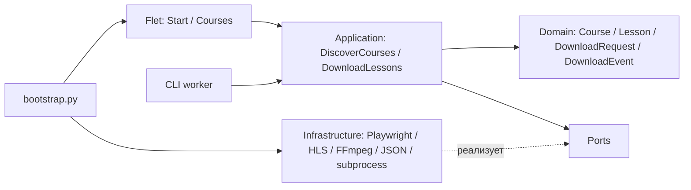

# Архитектура GetCourseVideoDownloader

`domain/` содержит модели, события и ошибки; `application/` — сценарии и порты. `infrastructure/` реализует браузер, обнаружение страниц, загрузку, хранение, worker и диагностику. `presentation/` содержит Flet и CLI. GUI соединяется в `bootstrap.py`; у CLI worker собственная сборка адаптеров в `presentation/cli/worker.py`. Направление импортов domain/application проверяет `tests/test_architecture.py`.

## Главный поток

1. `main.py` запускает Flet (или `--download-worker` / `--self-test`); GUI-скрипт также объявлен в `pyproject.toml`. `StartScreen` передаёт URL через `StartController` в `DiscoverCourses`, который проверяет схему URL и сохраняет найденные курсы через `JsonCourseRepository`.
2. `GetCourseDiscoverer` открывает постоянный профиль Firefox через `PlaywrightBrowserFactory`. При редиректе на вход он открывает видимый браузер, ждёт подтверждения пользователя и повторно проверяет страницу. Затем обходит ссылки GetCourse stream (не более 500 узлов, до 4 одновременно) и строит дерево `Course`. Модули читаются из `tr.training-row` и карточек `.training-list-wrapper a.card-link`, уроки — из `ul.lesson-list li` и `.LessonList-container a.card-link`; названия карточек берутся из `.training-card__header` / `.lesson-card_heading`. Для нового интерфейса код ждёт скрытия `.gc-redesigned .loader-skeleton` до 15 секунд; таймаут даёт `CONTENT_LOAD_TIMEOUT`, а не пустое дерево. Ссылки нормализуются, чужие домены и дубликаты отбрасываются; при отсутствии распознанных модулей сохраняется запасной поиск stream URL в HTML.
3. `CoursesScreen` показывает дерево, выбор уроков/папок и «Выбрать всё». `selected_course_lessons` создаёт список `SelectedLesson`; после выбора папки и качества `CoursesController` формирует `DownloadRequest`. Загрузка начинается по отдельному действию пользователя.
4. `DownloadLessons` проверяет запрос; `SubprocessDownloadGateway` передаёт его дочернему worker через временный JSON и читает типизированные `DownloadEvent` из JSONL. Команды продолжения авторизации и отмены передаются отдельным JSONL-файлом. Worker создаёт `PlaywrightDownloadGateway`.
5. Worker последовательно открывает **выбранные** страницы уроков в авторизованном контексте Firefox. Страница GetCourse «Нет доступа» распознаётся отдельно от отсутствия видео. `PlaywrightDownloadGateway` слушает ответы браузера на HLS и ищет HLS-ссылки во фреймах; потоки сопоставляются со всеми найденными плеерами, затем выбирается вариант качества. `HlsDownloader` отдельной `aiohttp`-сессией получает playlist и сегменты, возобновляет совместимый checkpoint, вызывает `FfmpegMuxer`, атомарно переносит результат в MP4. При отдельной HLS-аудиодорожке она скачивается и объединяется с видео.
6. События обновляют строки уроков, прогресс и итог в Flet. `JsonDownloadCatalog` и уже существующие файлы помогают пропускать готовое; `.gcd-part` хранит сегменты для продолжения. Отмена идёт из UI через worker, проверяется между действиями; закрытие экрана может принудительно завершить процесс после ожидания. Ошибки уроков и запуска пишутся в отчёты диагностики.

## Где искать

| Задача | Файл / модуль |
| --- | --- |
| Точки входа и сборка зависимостей | `main.py`, `src/getcourse_downloader/__main__.py`, `src/getcourse_downloader/bootstrap.py`, `src/getcourse_downloader/presentation/cli/worker.py` |
| Flet: ввод URL, выбор, прогресс, отмена | `presentation/flet/app.py`, `presentation/flet/screens/start/`, `presentation/flet/screens/courses/` внутри `src/getcourse_downloader/` |
| Сценарии, контракты, модели и события | `src/getcourse_downloader/application/`, `src/getcourse_downloader/domain/` |
| Курсы, уроки, вход и браузерный профиль | `src/getcourse_downloader/infrastructure/getcourse/discovery.py`, `authentication.py`, `infrastructure/browser/playwright.py` |
| Доступ к уроку и перехват медиа | `src/getcourse_downloader/infrastructure/getcourse/lesson_access.py`, `downloader.py`, `video_signals.py` |
| HLS, идентичность плейлистов, checkpoint и FFmpeg | `src/getcourse_downloader/infrastructure/media/hls.py`, `playlist_identity.py`, `ffmpeg.py` |
| Worker, события и управление процессом | `src/getcourse_downloader/infrastructure/worker/subprocess_gateway.py`, `presentation/cli/worker.py`, `domain/events.py` |
| Настройки, каталог готовых файлов, пути, диагностика | `src/getcourse_downloader/infrastructure/storage/`, `infrastructure/platform/paths.py`, `infrastructure/diagnostics/reports.py` |
| Зависимости, проверки и Windows ZIP | `pyproject.toml`, `uv.lock`, `tests/`, `README.md`, `build.ps1` |

## Границы реализации

- Итог загрузки, список проблемных уроков и отчёт по одному уроку показываются последовательно в одном Flet overlay. Сводка неподвижна; список имеет одну собственную область прокрутки и занимает доступную высоту окна. Возврат из отчёта восстанавливает тот же список, а возврат из списка — итог. В списке доступны также отчёты уроков без найденного видео. Закрытие завершённого сценария не может скрыть окно активной загрузки. Переходы и запоздавшее закрытие проверяет `tests/test_completion_flow.py`.

- Поиск потоков завершается после короткой паузы в ответах только тогда, когда получены плейлисты для всех распознанных iframe-плееров. Сопоставление использует временные идентификаторы фреймов и их родителей, учитывает вложенные запросы, одинаковые URL в разных плеерах и ещё не загрузившийся iframe; эти идентификаторы не сохраняются. Если после таймаута найдены только некоторые потоки, выдаётся `PLAYER_STREAMS_INCOMPLETE`, а неполный набор не отмечается как готовый урок. Отдельная страница GetCourse с заголовком «Нет доступа» даёт `LESSON_ACCESS_DENIED` на этапе `access`; это не `VIDEO_NOT_FOUND`. Vimeo и GetCourse sign-player входят в распознаваемые плееры. Проверки — `tests/test_downloader_outcomes.py` и `tests/test_video_signals.py`.

- При частично успешной загрузке сегментов после временных сетевых ошибок выполняется один дополнительный проход только по неудачным ресурсам. Повторяются таймауты, ошибки соединения, HTTP 408/429/500/502/503/504; готовые сегменты сохраняются и повторно не скачиваются. Число попыток ограничено, отмена действует во время паузы и повторных запросов, постоянный отказ сохраняет checkpoint и выдаёт исходную ошибку. HTTP 403 не получает дополнительного прохода. `tests/test_hls_resume.py` проверяет восстановление, ограничения и отмену; `tests/test_hls_ffmpeg.py` проверяет реальный локальный HTTP 504 с последующей сборкой, объединением и декодированием видео и звука.

- При сравнении HLS-ссылок вращающиеся подписи (`token`, `sign`, `pathsig` и другие известные параметры авторизации) исключаются из идентичности медиа. Параметры самого видео, дорожки и качества сохраняются: разные видео на одном URL-пути не объединяются. Для выбора потоков и исключения захваченных вариантов master используется `playlist_identity.py`: в распознанной структуре Vimeo v2 на `*.vimeocdn.com` сравниваются идентификатор ролика, путь варианта и дорожка; CDN, подписанный префикс пути, `psid` и параметры доставки `qsr/r/rh` не создают новые видео. Остальные провайдеры и структуры используют прежнюю консервативную нормализацию. URL сетевых запросов и идентичность checkpoint этим правилом не изменяются. `tests/test_playlist_identity.py` проверяет границы правила; `tests/test_downloader_outcomes.py` использует синтетический образец структуры Vimeo (`tests/fixtures/vimeo_alternate_cdns.json`): 12 альтернативных master дают три видео для 360p, 720p и авто, а четвёртый ролик сохраняется. Названия HTML-образца, URL, идентификаторы и значения подписей в новых образцах ограничены фиксированными тестовыми значениями; это проверяет `tests/test_public_fixtures.py`. `tests/test_hls_resume.py` проверяет продолжение при изменении только `pathsig` и разделение разных видео/дорожек.

- HLS с `EXT-X-MAP` собирается как единый бинарный поток: init-блок и следующие фрагменты MP4 зависят друг от друга. Concat-demuxer используется для самостоятельных TS-сегментов; применение его к init-блоку и `.m4s` может закончиться кодом 0 и пустым MP4. Все операции FFmpeg требуют непустого результата (`-abort_on empty_output`), поэтому такой файл не становится готовым видео и checkpoint сохраняется при ошибке. Захваченные аудиоплейлисты, связанные с вариантами master, исключаются из самостоятельных видео и загружаются как их аудиодорожки. `tests/test_hls_ffmpeg.py` проверяет локальный HLS с настоящими FFmpeg/FFprobe: наличие пакетов видео и звука, объединение, декодирование и отказ для одного init-блока без медиа. Прежние TS, checkpoint и выбор плейлистов проверяют `tests/test_hls_resume.py`, `tests/test_ffmpeg.py` и `tests/test_downloader_outcomes.py`.

- В классическом `ul.lesson-list` URL урока читается из `<a href>`; если у внешнего `<a>` нет адреса, используется `href` вложенного `div.link.title`. Так в дерево попадают и перечисленные сайтом уроки с отложенным доступом (`user-state-not_reached`). Это сохраняет видимую структуру, но не подтверждает доступ к видео: его проверяет сайт при открытии урока. URL не выдумывается из `data-lesson-id`; нормализация и удаление дубликатов остаются общими для списков и карточек. Регрессии: `tests/test_parse_courses.py` проверяет ссылки и итоговые счётчики вложенного дерева; `tests/test_redesigned_discovery.py` проверяет DOM в изолированном Firefox на обезличенном `tests/fixtures/scheduled_lesson_list.html` вместе с прежними вариантами разметки.

- **Подтверждено кодом:** дерево stream/уроков может быть найдено автоматически; после выбора worker сам проходит каждый выбранный урок. Кнопка «Выбрать всё» есть, но запуск не автоматический. Поиск зависит от поддерживаемых URL и HTML-структуры GetCourse; нет доказательства полноты для всех школ, нестандартных страниц или скрытых уроков.
- **Подтверждено кодом:** загрузчик обрабатывает HLS. DASH распознаётся для ошибки `DASH_STREAM_UNSUPPORTED`; отдельного пути для прямого MP4 или самостоятельного аудиофайла в этом `main` нет. Плеер определяется селектором, но общий механизм его принудительного запуска на каждой странице не прослеживается. Отсутствие HLS даёт `PLAYLIST_NOT_OBSERVED` или `VIDEO_NOT_FOUND`.
- **Подтверждено кодом:** браузер использует постоянный профиль, а HLS скачивается отдельной `aiohttp`-сессией с `User-Agent`, `Referer`, `Origin`; явная передача cookies браузера в неё не найдена. Доступные браузеру, но требующие cookies/CDN-условий сегменты могут не загрузиться — это **гипотеза**, требующая проверки на реальном курсе.
- **Требует проверки на реальном курсе:** вход и повторный вход, полнота списка уроков, HLS разных плееров/CDN, итоговые MP4, отмена и продолжение после сбоя. `build.ps1` описывает упаковку Firefox/FFmpeg, worker smoke, ZIP, SHA-256 и SBOM; готовый EXE здесь не запускался.

