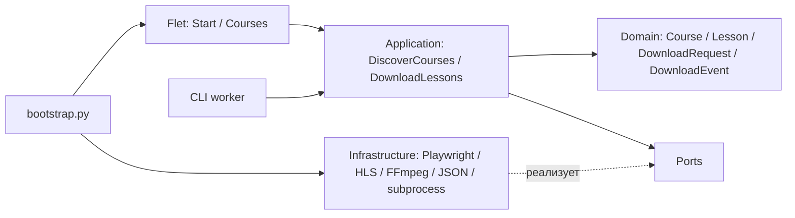

# Архитектура GetCourseVideoDownloader

`domain/` содержит модели, события и ошибки; `application/` — сценарии и порты. `infrastructure/` реализует браузер, обнаружение страниц, загрузку, хранение, worker и диагностику. `presentation/` содержит Flet и CLI. GUI соединяется в `bootstrap.py`; у CLI worker собственная сборка адаптеров в `presentation/cli/worker.py`. Направление импортов domain/application проверяет `tests/test_architecture.py`.

## Главный поток

1. `main.py` запускает Flet (или `--download-worker` / `--self-test`); GUI-скрипт также объявлен в `pyproject.toml`. `StartScreen` передаёт URL через `StartController` в `DiscoverCourses`, который проверяет схему URL и сохраняет найденные курсы через `JsonCourseRepository`.
2. `GetCourseDiscoverer` открывает постоянный профиль Firefox через `PlaywrightBrowserFactory`. При редиректе на вход он открывает видимый браузер, ждёт подтверждения пользователя и повторно проверяет страницу. Затем обходит ссылки GetCourse stream (не более 500 узлов, до 4 одновременно) и строит дерево `Course`. HTTP 403 у отдельного найденного курса или модуля помечает его как пропущенный (`CourseDiscoveryUpdate.skipped`), исключает из итогового дерева и не прерывает обход доступных соседей и потомков. Отказ для самой исходной ссылки и другие ошибки остаются явными ошибками. Модули читаются из `tr.training-row` и карточек `.training-list-wrapper a.card-link`, уроки — из `ul.lesson-list li` и `.LessonList-container a.card-link`; названия карточек берутся из `.training-card__header` / `.lesson-card_heading`. Для нового интерфейса код ждёт скрытия `.gc-redesigned .loader-skeleton` до 15 секунд; таймаут даёт `CONTENT_LOAD_TIMEOUT`, а не пустое дерево. Ссылки нормализуются, чужие домены и дубликаты отбрасываются; при отсутствии распознанных модулей сохраняется запасной поиск stream URL в HTML.
3. `CoursesScreen` показывает дерево, выбор уроков/папок и «Выбрать всё». `selected_course_lessons` создаёт список `SelectedLesson`. По действию «Скачать выбранное» экран сразу показывает лёгкую карточку подготовки и планирует отдельную UI-задачу: проверка папки выполняется через `asyncio.to_thread`, строки создаются и подключаются группами по 24 урока с передачей управления между группами. Группы имеют отдельные Flet-контролы, поэтому очередной шаг обновляет только новую группу и счётчик подготовки. Затем `CoursesController` формирует `DownloadRequest` и запускает worker. Отмена или dispose во время подготовки останавливает задачу до запуска worker; повторные нажатия заблокированы состоянием и не вызывают автообновление страницы.
4. `DownloadLessons` проверяет запрос; `SubprocessDownloadGateway` передаёт его дочернему worker через временный JSON и читает типизированные `DownloadEvent` из JSONL. Команды продолжения авторизации и отмены передаются отдельным JSONL-файлом. Worker создаёт `PlaywrightDownloadGateway`.
5. Worker последовательно открывает **выбранные** страницы уроков в авторизованном контексте Firefox. Страница GetCourse «Нет доступа» распознаётся отдельно от отсутствия видео. `PlaywrightDownloadGateway` ограничивает всю проверку одного урока 60 секундами: от создания страницы до выбора потоков, включая подготовку персонального видео. Превышение даёт `VIDEO_CHECK_TIMEOUT` в отчёте урока для «Подробнее»; очередь продолжает работу. Лимит отключается перед передачей управления в `HlsDownloader`, поэтому скачивание и сборка MP4 могут длиться дольше. Адаптер слушает ответы браузера на HLS и ищет HLS-ссылки во фреймах. Запасной поиск проверяет каждый URL-подобный фрагмент HTML один раз, чтобы большие встроенные изображения не блокировали event loop; чтение HTML и запросы найденных плейлистов ограничены по времени, запрос браузера прерывается через `AbortController`. Для GetCourse `/sign-player/` адаптер `player_config.py` также читает известные поля `window.configs`: проверяет текущую готовность, при необходимости запрашивает подготовку персонального видео и получает `masterPlaylistUrl` внутри авторизованного iframe без нажатий. Оба источника передают URL и текст плейлиста в общий выбор качества; потоки сопоставляются со всеми найденными плеерами. `HlsDownloader` отдельной `aiohttp`-сессией получает playlist и сегменты, возобновляет совместимый checkpoint, вызывает `FfmpegMuxer`, атомарно переносит результат в MP4. При отдельной HLS-аудиодорожке она скачивается и объединяется с видео.
6. События обновляют строки уроков, прогресс и итог в Flet через `presentation/flet/lifecycle.py`. Рабочие потоки помещают callbacks в очередь до 256 элементов; заполнение приостанавливает производителя. Соседние обновления прогресса одного видео объединяются, сохраняя порядок остальных событий. Единственная задача `page.run_task` выполняет callbacks в UI-цикле и отдаёт управление после 8 мс обработки. Проверки времени жизни действуют до постановки в очередь и перед выполнением. При dispose очередь очищается, ожидающие производители освобождаются; если сессия уничтожена, экран запрашивает отмену активной загрузки. Прочие ошибки не подавляются. Прогресс обновляет конкретную строку и изменившиеся показатели вместо всей страницы. `JsonDownloadCatalog` и уже существующие файлы помогают пропускать готовое; `.gcd-part` хранит сегменты для продолжения. Отмена идёт из UI через worker, проверяется между действиями; закрытие экрана может принудительно завершить процесс после ожидания.
7. Ошибки уроков и запуска пишутся в отчёты диагностики атомарно через временный файл и замену; отчёт урока считается сохранённым только после успешной записи. `screens/courses/diagnostics.py` показывает «Подробнее» отдельным слоем, сохраняя подключёнными список загрузки и текущий итог. Основной источник текста — очищенный снимок первого события ошибки (`DownloadDiagnostics.describe`). Если снимка нет, файл читается через `asyncio.to_thread`; номер поколения и отмена задачи защищают от устаревшего результата после «Назад» или закрытия экрана. Завершение загрузки при открытом отчёте обновляет итог под ним: «Назад» показывает актуальное состояние. Обработчики прокрутки списка загрузки и возврата из отчёта отключают автоматическое обновление Flet для своего события: прокрутка меняет только состояние слежения, а возврат явно обновляет слой отчёта. Это предотвращает полный обход страницы после каждого уведомления прокрутки или запоздалого повторного нажатия «Назад». Проверки таких обработчиков проходят через `Session.dispatch_event`, включая `after_event`; прямой вызов метода экрана этот этап не проверяет.

При открытии выбранного урока HTTP 403 основного документа сразу даёт `LESSON_ACCESS_DENIED` на этапе `access`; очередь переходит к следующему уроку без ожидания видеопотоков. Статус берётся из существующего ответа браузера без дополнительного запроса. Проверка `lesson_access.py` также распознаёт страницу GetCourse «Возникла ошибка #403» вместе с сообщением «У вас нет доступа к этому уроку», в том числе при HTTP 200. Для определения доступа по HTTP учитывается только основной документ урока.

`presentation/flet/transitions.py` управляет появлением и закрытием уже подключённых слоёв загрузки и отчёта: прозрачность, небольшой масштаб и смещение анимируются клиентом за 190 мс при открытии и 140 мс при закрытии. Начальное состояние отправляется отдельно от конечного через следующий кадр UI-цикла. `PreparationReveal` оставляет уже смонтированные строки под непрозрачным экраном подготовки и снимает его прозрачностью за 200 мс, не задерживая worker. Номер поколения и отмена задачи предотвращают запоздалое скрытие при быстром повторном открытии; dispose останавливает переходы.

`screens/courses/download_follow.py` хранит единственный координатор автопрокрутки. Он запоминает последнюю цель, ждёт 350-миллисекундное клиентское движение и объединяет события более быстрых уроков, поэтому не создаёт новую задачу на каждое событие worker и не повторяет уже достигнутую позицию. Нажатие или ручная прокрутка приостанавливают слежение на 10 секунд; отчёт удерживает его выключенным, а «Назад» начинает такой же интервал заново. Наведение указателя не останавливает очередь. Системные события Flet (сворачивание, фокус, resize и смена яркости) регистрируются в `app.py` как наблюдения и отключают автоматический Page update: у них нет изменений контролов, поэтому они не обходят весь большой список.

Строки загрузки сохраняют высоту и место для статуса и «Подробнее»: смена состояния не сдвигает название и соседние строки. `DownloadLessonRow` в `components.py` меняет содержимое `AnimatedSwitcher` только при смене значка, текста или цвета; одинаковые события ошибки и обновления процентов не перезапускают появление. Статус плавно сменяется за 200 мс, небольшое смещение и масштаб получают мягкий пружинящий возврат за 220 мс. `RowTransitions` объединяет конечные состояния в одну отправку после следующего кадра; промежуточные кадры рисует клиент, без Python-цикла анимации и задержки worker. Подсветка активной строки плавно меняется за 220 мс; автопрокрутка замедляется к цели за 350 мс. Новая загрузка, завершение и dispose отменяют неподтверждённые переходы строк.

## Журнал действий и задержек

`infrastructure/diagnostics/ui_lifecycle.py` обслуживает семейство логгеров `getcourse_downloader.ui` и файл `data/ui-lifecycle.log`: до 1 МБ на файл и две резервные копии. Отдельный поток записывает сообщения на диск; UI и worker только ставят их в очередь. Очередь DEBUG ограничена 2048 сообщениями, избыток учитывается записью `ui_log_debug_dropped`; INFO и более важные сообщения сохраняются без такого отбрасывания. При закрытии приложение ожидает записи очереди вне UI-цикла.

`trace_operation` записывает начало, завершение, длительность и тип исключения ключевых действий. Callback-журнал содержит время ожидания очереди и обработки, а worker-журнал — запуск и завершение процесса, этапы событий, порядковый номер урока, счётчики, отмену и принудительную остановку. Прогресс worker записывается не чаще раза в секунду. Метаданные ограничены безопасными скалярами и известными кодами; аргументы функций, содержимое уроков, тексты исключений, URL, отчёты и сетевые ответы не журналируются. Ошибки клиента Flet получают тип и короткий отпечаток вместо исходного текста.

## Где искать

| Задача | Файл / модуль |
| --- | --- |
| Точки входа и сборка зависимостей | `main.py`, `src/getcourse_downloader/__main__.py`, `src/getcourse_downloader/bootstrap.py`, `src/getcourse_downloader/presentation/cli/worker.py` |
| Flet: ввод URL, выбор, прогресс, отмена | `presentation/flet/app.py`, `presentation/flet/screens/start/`, `presentation/flet/screens/courses/` внутри `src/getcourse_downloader/` |
| Сценарии, контракты, модели и события | `src/getcourse_downloader/application/`, `src/getcourse_downloader/domain/` |
| Курсы, уроки, вход и браузерный профиль | `src/getcourse_downloader/infrastructure/getcourse/discovery.py`, `authentication.py`, `infrastructure/browser/playwright.py` |
| Доступ к уроку, перехват медиа и подготовка GetCourse-плеера | `src/getcourse_downloader/infrastructure/getcourse/lesson_access.py`, `downloader.py`, `video_signals.py`, `player_config.py` |
| HLS, идентичность плейлистов, checkpoint и FFmpeg | `src/getcourse_downloader/infrastructure/media/hls.py`, `playlist_identity.py`, `ffmpeg.py` |
| Worker, события и управление процессом | `src/getcourse_downloader/infrastructure/worker/subprocess_gateway.py`, `presentation/cli/worker.py`, `domain/events.py` |
| Настройки, каталог готовых файлов, пути, диагностика | `src/getcourse_downloader/infrastructure/storage/`, `infrastructure/platform/paths.py`, `infrastructure/diagnostics/reports.py` |
| Зависимости, проверки и Windows ZIP | `pyproject.toml`, `uv.lock`, `tests/`, `README.md`, `build.ps1` |

