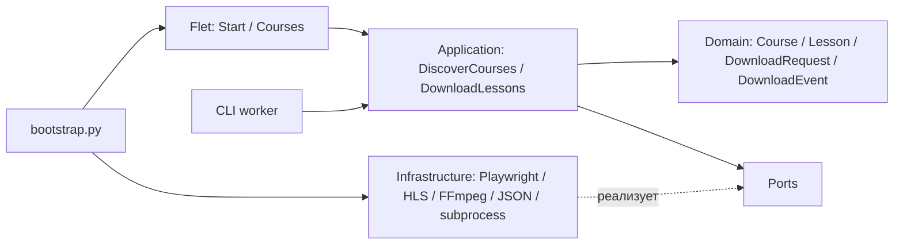

# Архитектура GetCourseVideoDownloader

`domain/` содержит модели, события и ошибки; `application/` — сценарии и порты. `infrastructure/` реализует браузер, обнаружение страниц, загрузку, хранение, worker и диагностику. `presentation/` содержит Flet и CLI. GUI соединяется в `bootstrap.py`; у CLI worker собственная сборка адаптеров в `presentation/cli/worker.py`. Направление импортов domain/application проверяет `tests/test_architecture.py`.

При запуске из исходников фабрика проверяет путь к Firefox, который возвращает
текущий Playwright. Если файла нет, фабрика запускает `python -m playwright install firefox`
тем же интерпретатором и проверяет результат до открытия профиля. При ошибке скачивания
приложение показывает `BROWSER_INSTALL_FAILED`. В EXE фабрика использует
`resources/ms-playwright` и проверяет наличие
именно исполняемого файла, ожидаемого Playwright. `build.ps1` устанавливает браузер
текущей версии Playwright непосредственно в этот каталог и проверяет его путь:
наличие произвольного `firefox-*` не подтверждает совместимость после обновления зависимостей.

## Где искать

Обнаружение уроков поддерживает классические списки, карточки нового интерфейса
и переходы через картинки конструктора GetCourse (`.xdget-image`). У картинок
адрес может находиться только в JSON-параметре `params.link` инициализации
`xdget_image`, без `<a href>`. `discovery.py` читает эти параметры без исполнения
скриптов, связывает их с существующим блоком страницы тренинга, нормализует URL
и удаляет дубликаты вместе с обычными уроками. Для таких дополнительных ссылок
браузерный контекст запрашивает HTML урока в текущей сессии. Заголовок берётся
из `.lesson-title-value` или заголовка внутри `.lesson-header-block`, поскольку
общий `h1` может содержать название курса. HTML разбирается без открытия вкладок
уроков и загрузки их ресурсов. Запросы заголовков имеют таймаут и общий лимит
параллельности на весь обход. При HTTP 403/404 или отсутствии заголовка остаётся
подпись картинки либо «Урок <идентификатор>». Сетевые ошибки и завершение сессии
показываются пользователю. Названия обычных списков и карточек читаются со страницы
списка.
Формат сохранения общий: один ролик — `<название>_<качество>.mp4`, несколько —
папка урока с `video_1_<качество>.mp4`, `video_2_<качество>.mp4` и далее. Эта
поддержка не меняет выбор качества, каталог загрузок и имена существующих файлов.
Полнота обхода модулей и скачивание требуют отдельной проверки на доступном курсе.

| Задача | Файл / модуль |
| --- | --- |
| Точки входа и сборка зависимостей | `main.py`, `src/getcourse_downloader/__main__.py`, `src/getcourse_downloader/bootstrap.py`, `src/getcourse_downloader/presentation/cli/worker.py` |
| Flet: ввод URL, выбор, прогресс, отмена | `presentation/flet/app.py`, `presentation/flet/screens/start/`, `presentation/flet/screens/courses/` внутри `src/getcourse_downloader/` |
| Сценарии, контракты, модели и события | `src/getcourse_downloader/application/`, `src/getcourse_downloader/domain/` |
| Курсы, уроки, вход и браузерный профиль | `src/getcourse_downloader/infrastructure/getcourse/discovery.py`, `authentication.py`, `infrastructure/browser/playwright.py` |
| Доступ к уроку, перехват медиа и подготовка GetCourse-плеера | `src/getcourse_downloader/infrastructure/getcourse/lesson_access.py`, `downloader.py`, `video_signals.py`, `player_config.py` |
| HLS, идентичность плейлистов, checkpoint и FFmpeg | `src/getcourse_downloader/infrastructure/media/hls.py`, `playlist_identity.py`, `ffmpeg.py` |
| Worker, события и управление процессом | `src/getcourse_downloader/infrastructure/worker/subprocess_gateway.py`, `presentation/cli/worker.py`, `domain/events.py` |
| Настройки, каталог готовых файлов, пути, диагностика | `src/getcourse_downloader/infrastructure/storage/`, `infrastructure/platform/paths.py`, `infrastructure/diagnostics/reports.py` |
| Поиск и удаление точных копий видео | `presentation/flet/screens/courses/duplicates.py` → контроллер → `infrastructure/storage/video_duplicates.py` |
| Зависимости, проверки и Windows ZIP | `pyproject.toml`, `uv.lock`, `tests/`, `README.md`, `build.ps1` |

